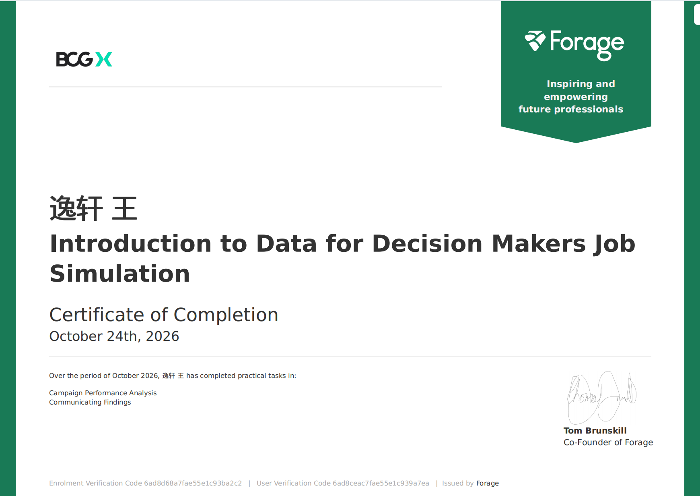

# BCG X - Introduction to Data for Decision Makers (Forage)

## 📌 Project Overview
Completed a virtual job simulation simulating the role of a Data Scientist / Consultant at BCG X. Analyzed multi-channel marketing campaign data for a fictional client (NewCo) to identify strategic growth opportunities.

## 📊 Key Insights
*   **Overall Performance**: Campaign B generated higher total sales overall ($8,790.04 vs. $5,869.56).
*   **New Customer Shift**: When isolating for new customers, **Campaign A + Email** proved to be the most effective combination, generating the highest new customer sales ($2,124.47).
*   **Channel Dominance**: Email is the top-performing channel, accounting for over 60% of new customer sales.

## 💡 Recommendation
Recommended that NewCo reallocate budget to **double down on Campaign A via the Email channel** to maximize ROI and accelerate new customer acquisition.

## 📁 Repository Contents
*   `Campaign_Data_Week1.xlsx`: The raw data, pivot tables, and slicers used for analysis.
*   `slide.pptx`: The final client-ready presentation summarizing findings and strategic recommendations.

## 🏆 Certification

*(Completed on October 24, 2026)*
